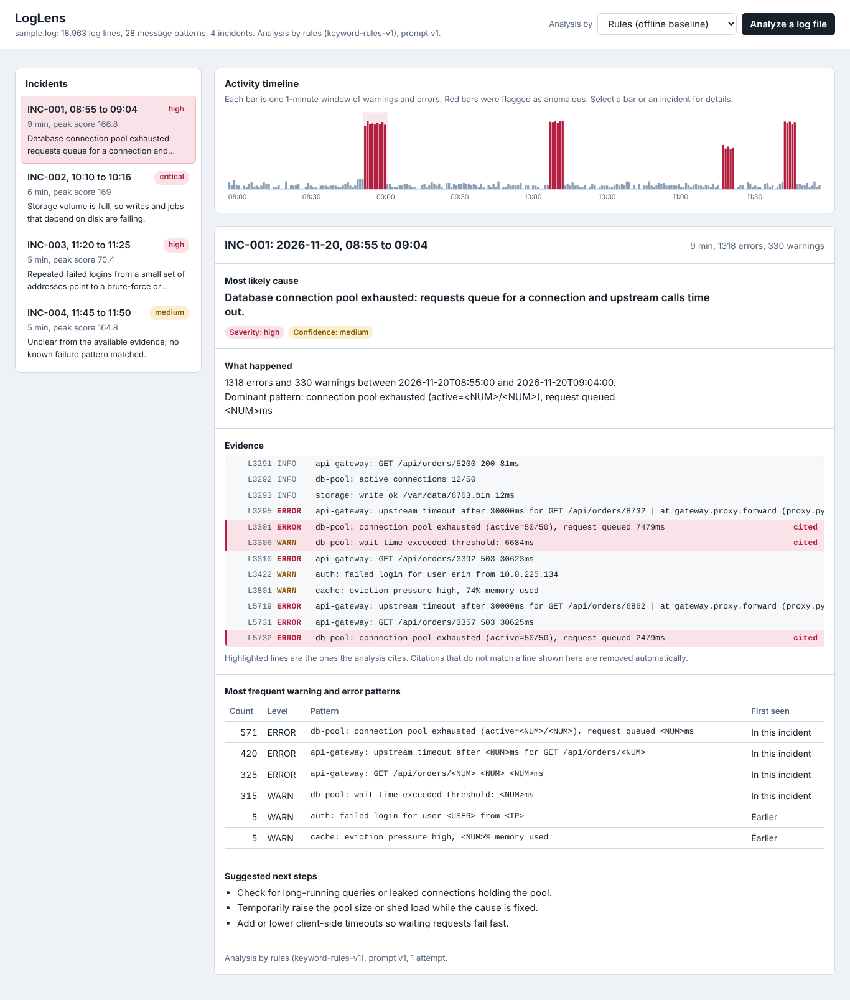

# LogLens

LogLens reads application logs, finds the time windows where something went wrong, and asks an LLM to explain each incident. The model never sees the whole log. It receives a short statistical summary of one incident plus a numbered list of evidence lines, and every answer is validated before it is shown.



## Contents

- [Why this exists](#why-this-exists)
- [What it does](#what-it-does)
- [Quick start](#quick-start)
- [Using a real LLM](#using-a-real-llm)
- [How it works](#how-it-works)
- [Evaluation](#evaluation)
- [Project layout](#project-layout)
- [Design decisions](#design-decisions)
- [Limitations](#limitations)
- [Next steps](#next-steps)

## Why this exists

Logs are large, noisy and mostly boring. When something breaks, an engineer has to find the few minutes that matter, then work out why. LogLens automates the first part with simple, explainable statistics, and uses an LLM for the second part on a small, well-chosen slice of the data. This keeps cost and latency low, limits what is sent to a model provider, and makes the model's claims checkable.

## What it does

1. **Parses logs** in the format `YYYY-MM-DD HH:MM:SS LEVEL component: message`, including multi-line stack traces.
2. **Mines message patterns** by masking numbers, IP addresses, UUIDs, hex values and user names. "GET /api/orders/1042 200 38ms" and "GET /api/orders/7 200 91ms" become one pattern.
3. **Detects anomalous time windows** by comparing each window with a rolling robust baseline, plus a signal for several never-seen warning or error patterns appearing at once.
4. **Analyses each incident with an LLM** and returns structured JSON: summary, root cause, confidence, severity, cited log lines and recommended actions.
5. **Validates every answer.** The schema is checked, citations must refer to lines that were actually sent, and bad output triggers a retry and then a fallback.
6. **Evaluates itself** against labelled incidents so providers and prompt versions can be compared on the same data.
7. **Shows the result in a dashboard** with a timeline, an incident list, and the evidence lines the analysis cites.

## Quick start

Requires Python 3.10 or newer. No third-party packages. Developed and tested on Python 3.12.

```bash
python -m loglens generate                  # synthetic log and labels in data/
python -m loglens analyze data/sample.log   # writes results/report.json
python -m loglens evaluate                  # writes results/eval.md
python -m loglens serve                     # dashboard at http://127.0.0.1:8000
python -m unittest discover -s tests -v     # 25 tests
```

On Windows, use `py` instead of `python` if `python` is not recognised.

In the dashboard you can also upload any log file in the supported format. The provider selector there uses the same environment variables described below.

## Using a real LLM

The default provider, `rules`, is an offline keyword baseline. It is not a model. To use an LLM, set environment variables and pass `--provider`.

**OpenAI-compatible APIs** (Gemini, OpenAI, Ollama, vLLM and others):

```bash
# macOS / Linux
export LOGLENS_API_KEY=your_key
export LOGLENS_BASE_URL=https://generativelanguage.googleapis.com/v1beta/openai
export LOGLENS_MODEL=gemini-3.5-flash-lite
python -m loglens evaluate --provider openai
```

```bat
:: Windows cmd, one line at a time
set LOGLENS_API_KEY=your_key
set LOGLENS_BASE_URL=https://generativelanguage.googleapis.com/v1beta/openai
set LOGLENS_MODEL=gemini-3.5-flash-lite
python -m loglens evaluate --provider openai
```

**Anthropic:**

```bash
export ANTHROPIC_API_KEY=your_key
export LOGLENS_MODEL=your_model_name      # optional
python -m loglens evaluate --provider anthropic
```

Notes:

- Model names change over time. If you get a 404, pick a current model from your provider.
- The OpenAI-compatible provider has been run against Gemini (see [Evaluation](#evaluation)). The Anthropic provider is covered by tests with fake providers but has not been run against the live API.
- Keep keys in environment variables. Never commit them.
- The prompt contains log lines. Redact anything sensitive before sending real logs to a hosted model.

## How it works

```
log file -> parser -> windows -> detector -> incidents -> prompt -> provider -> validator -> report.json -> dashboard
              |                                                       |            |
         template mining                                      rules or LLM    schema, citation check,
                                                                              retry, fallback
```

### 1. Parsing and template mining

`parser.py` turns each line into a record with timestamp, level, component, message and a template ID. Lines that do not start with a timestamp are attached to the previous record as continuation lines, which keeps stack traces together. The template ID includes the log level, so an `INFO` and an `ERROR` message with the same text count as different patterns.

### 2. Detection

`detector.py` groups records into fixed windows (60 seconds by default) and gives each window a severity score:

```
severity = errors + 0.25 * warnings
```

Each window is compared with the median and median absolute deviation (MAD) of the last 30 non-anomalous windows. The robust z-score uses a scale floor of 1.0, because sparse error counts often have a MAD of zero. A window is flagged when:

- its z-score is at least 4.0, or
- at least two warning or error patterns appear for the first time in that window.

Nothing is flagged during the first 8 windows, because there is no baseline yet. Flagged windows are excluded from the baseline, so a long incident cannot teach the detector that it is normal. Adjacent flagged windows, allowing a gap of one, are merged into a single incident.

For each incident the detector picks up to 14 evidence lines: the first occurrence of each top pattern, the last occurrence of the top three, and the three lines just before the incident started.

### 3. LLM analysis and guardrails

`llm.py` builds a prompt from the incident summary and evidence and asks for one JSON object. The system prompt tells the model to use only the provided facts, cite line numbers, and set low confidence when the evidence is not enough. Every answer then passes these checks:

| Check | What happens on failure |
|---|---|
| Output contains valid JSON (code fences and chatter are stripped) | Retry once with the error message |
| Fields match the schema, including allowed values for confidence and severity | Retry once |
| Cited line numbers exist in the evidence that was sent | Invalid citations are dropped and noted |
| At least one valid citation remains | Otherwise confidence is lowered to "low" |
| Two attempts failed, or the API was unreachable | Fall back to the rule-based provider and record that |

Each result stores provider, model, prompt version, number of attempts and any issues, so a run can be audited later.

## Evaluation

`evaluate.py` scores a run against labelled incidents.

**Detection:** window-level precision, recall and F1, incidents found, false incidents, and detection delay.

**Analysis**, per matched incident:

- *Root cause correct:* the root-cause text contains an expected keyword for that incident.
- *Citation precision:* the share of cited lines that really belong to the injected incident.
- *Clean output:* no validation issues and no fallback.

### Data

`generate.py` creates four hours of service logs (about 19,000 lines, 28 message patterns) with four labelled incidents. Real production logs are private, so this synthetic set lets the harness be tested end to end.

| Incident | Failure | Covered by the rules baseline |
|---|---|---|
| A | Database connection pool exhaustion | Yes |
| B | Disk full on a storage node | Yes |
| C | Credential stuffing against the auth service | Yes |
| D | Expired TLS certificate on a payments upstream | No, by design |

### Results

Detection does not use the model, so it is identical for both providers: window precision 1.0, recall 1.0, F1 1.0, 4 of 4 incidents found, no false incidents, zero detection delay.

Analysis results:

| | Rules baseline | LLM (`gemini-3.5-flash-lite`) |
|---|---|---|
| Root cause correct | 3 of 4 (0.75) | 4 of 4 (1.0) |
| Mean citation precision | 1.0 | 0.938 |
| Clean outputs | 4/4 | 4/4 |
| Confidence reported | medium, medium, medium, low | high on all four |
| Incident D | "Unclear", low confidence | Expired SSL/TLS certificate on the payments upstream |

The LLM run used the OpenAI-compatible endpoint, temperature 0.1, prompt version v1, one run on 2026-11-22. Full tables are in `results/eval_gemini.md` and `results/eval_rules.md`.

The rules baseline has no rule for an expired certificate, so it correctly reports that it is unsure. The model identified it from the evidence lines. Citation precision was 0.75 on incident C, meaning a quarter of the lines cited for that incident were not lines injected for it.

### How to read these numbers

- The data is synthetic and the incidents are far louder than normal traffic, so perfect detection is expected. It shows the pipeline works, not that it will work on real logs.
- The rules baseline was written for incidents A to C, so its score on them proves little. The informative case is incident D.
- This is one model, one run and four incidents. It is a demonstration, not a benchmark.
- The model reported high confidence on every incident, including the one with the lowest citation precision, so confidence calibration is untested.
- LLM output is not deterministic. Other runs may differ.

## Project layout

```
loglens/
  loglens/
    parser.py      line parsing, multi-line records, template masking
    detector.py    windows, robust baseline, novelty signal, incidents, evidence
    llm.py         prompt, providers, validation, retry and fallback
    pipeline.py    parse -> detect -> analyse -> report
    evaluate.py    detection metrics and analysis rubric
    generate.py    synthetic logs with labelled incidents
    server.py      dashboard and POST /api/analyze
    cli.py         generate, analyze, evaluate, serve
  dashboard/       single-file dashboard (HTML, CSS, JavaScript)
  tests/           25 unit and integration tests
  data/            sample log and ground-truth labels
  results/         reports and evaluation tables
  .github/         CI workflow that runs the tests
  Dockerfile       experimental, not yet tested
```

### API

`POST /api/analyze?provider=rules|openai|anthropic` with the raw log text as the request body returns the same JSON report the CLI writes. `GET /api/report` returns the report loaded at start-up.

## Design decisions

- **Detect first, explain second.** Statistics are cheap, fast and explainable. The LLM is used only where reasoning helps, on a small slice of the data.
- **Make the model checkable.** Requiring line citations and verifying them against what was sent turns "trust the model" into "verify the model".
- **Never fail the whole run on one bad answer.** Retry, then fall back, and record that it happened.
- **Keep a baseline in the evaluation.** Without a simple comparison, there is no way to tell whether the LLM adds anything.
- **No dependencies.** It runs anywhere Python runs, and the HTTP calls to model providers use only the standard library.

## Limitations

- One log format. Other formats need a new regex in `parser.py`.
- Template mining is regex-based. A dedicated algorithm such as Drain would group messages better.
- The baseline is frozen while a window is anomalous. A permanent change in normal behaviour would keep being flagged until the end of the log.
- Only warnings and errors are scored. A silent service (missing logs) is not detected.
- Evidence selection is heuristic. If the true cause is not among the top patterns, the model cannot see it.
- The whole file is read into memory. There is no streaming.
- The server is a minimal development server with no authentication. Do not expose it to a network.
- Evaluated only on synthetic data so far.

## Next steps

- Evaluate on public labelled log datasets such as the LogHub collection.
- Compare several models and prompt versions, and store each run in `results/`.
- Retrieve similar past incidents and runbooks to give the model more context.
- Streaming ingestion with a persistent baseline.
- Rebuild the dashboard in React on top of a FastAPI backend.

## Author

Hafsa Khan, B.Tech Computer Science and Engineering (class of 2027).
[GitHub](https://github.com/hafsakhan09090) · [LinkedIn](https://www.linkedin.com/in/-h-a-f-s-a-/)
