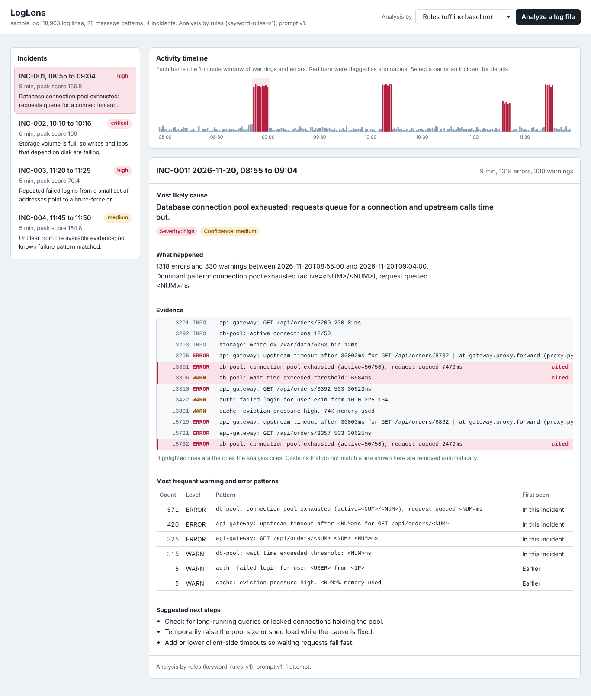

# LogLens

LogLens reads application logs, finds the time windows where something went wrong, and asks an LLM to explain each incident. The model never gets the full log. It gets a short statistical summary and a numbered list of evidence lines, and every answer is validated before it is shown.



## What it does

1. **Ingest and parse.** Reads `YYYY-MM-DD HH:MM:SS LEVEL component: message` logs, including multi-line stack traces.
2. **Template mining.** Masks numbers, IPs, UUIDs, hex values and user names, so "GET /api/orders/1042 200 38ms" and "GET /api/orders/7 200 91ms" count as one pattern.
3. **Anomaly detection.** Scores each time window and compares it with a rolling robust baseline (median and MAD). Windows flagged as anomalous are kept out of the baseline, so a long incident cannot teach the detector that it is normal. A second signal flags several new warning or error patterns appearing in the same window.
4. **LLM analysis.** For each incident, the model returns JSON with summary, root cause, confidence, severity, cited log lines and next steps.
5. **Guardrails.** Output is checked against a schema. Cited line numbers must exist in the evidence that was sent, otherwise they are dropped. An answer with no valid citation is downgraded to low confidence. After two unusable answers the run falls back to a rule-based provider instead of failing.
6. **Evaluation.** Scores detection and analysis against labelled incidents, so providers and prompt versions can be compared on the same data.
7. **Dashboard.** Timeline of anomalous windows, incident list, evidence with the cited lines highlighted.

## Quick start

Python 3.10+, no dependencies.

```bash
python -m loglens generate                 # synthetic log + labels in data/
python -m loglens analyze data/sample.log  # writes results/report.json
python -m loglens evaluate                 # writes results/eval.md
python -m loglens serve                    # dashboard at http://127.0.0.1:8000
python -m unittest discover -s tests -v    # 25 tests
```

You can also upload any log file in the dashboard.

## Using a real LLM

The default provider (`rules`) is an offline keyword baseline, not a model. To use an LLM:

```bash
# OpenAI-compatible APIs (OpenAI, Ollama, vLLM, ...)
export LOGLENS_API_KEY=...            # LOGLENS_BASE_URL and LOGLENS_MODEL are optional
python -m loglens evaluate --provider openai

# Anthropic
export ANTHROPIC_API_KEY=...          # LOGLENS_MODEL optional
python -m loglens evaluate --provider anthropic
```

Set `LOGLENS_MODEL` (or pass `--model`) to a model you have access to. The two API providers are implemented with the standard library and have only been exercised against fake providers in the tests, not live APIs. Run an evaluation with your own key and keep the output.

## Architecture

```
log file -> parser -> windows -> detector -> incidents -> prompt -> provider -> validator -> report.json -> dashboard
              |                                                       |            |
         template mining                                      rules / LLM    schema, citation check,
                                                                              retry, fallback
```

| File | Role |
|---|---|
| `loglens/parser.py` | line parsing, multi-line records, template masking |
| `loglens/detector.py` | windows, robust baseline, novelty signal, incident merging, evidence selection |
| `loglens/llm.py` | prompt, providers, JSON extraction, validation, retry and fallback |
| `loglens/evaluate.py` | detection metrics and analysis rubric |
| `loglens/generate.py` | synthetic logs with four labelled incidents |
| `loglens/server.py` | dashboard and `POST /api/analyze` |

## Evaluation

Run on the synthetic log (19k lines, four injected incidents, seed 7) with the offline `rules` provider:

| Metric | Value |
|---|---|
| Window precision / recall / F1 | 1.0 / 1.0 / 1.0 |
| Incidents detected | 4/4, no false incidents |
| Root cause accuracy | 0.75 (3 of 4) |
| Mean citation precision | 1.0 |

The one miss is incident D, an expired TLS certificate. The rules baseline has no rule for it, so it correctly says "unclear" with low confidence. That is the case an LLM is meant to handle, and the reason the evaluation compares providers.

**Read these numbers with care.** The data is synthetic and clean, and the incidents are far louder than normal traffic, so perfect detection is expected. The rules baseline was written for incidents A to C, so its score on them proves little. Real value comes from running `--provider` with an actual model, and from testing on public datasets with real noise.

## Limitations

- One log format. Other formats need a new regex in `parser.py`.
- Template mining is regex-based. A proper algorithm such as Drain would group messages better.
- The baseline is frozen while a window is anomalous. A permanent change in normal behaviour would keep being flagged until the log ends.
- The detector looks at warnings and errors only. Missing logs (a silent service) are not detected.
- Evidence selection is heuristic. If the true cause is not among the top patterns, the model cannot see it.
- No streaming. The whole file is read into memory.
- The server is a minimal development server with no authentication. Do not expose it.

## Ideas for next steps

- Evaluate on public log datasets with labelled anomalies (for example the LogHub collection).
- Retrieval over past incidents and runbooks, so the model can reuse known fixes.
- Streaming ingestion with persistent baselines.
- Compare prompt versions and models in `results/` and track them in git.
- Rebuild the dashboard in React with a FastAPI backend.
